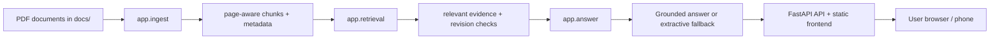

# Factory Copilot

Factory Copilot is a document-grounded assistant for plant supervisors. It answers questions only from the controlled PDFs in the project, shows the exact source document and page, and refuses unsupported or unsafe answers instead of guessing.

The application is designed for maintenance, quality, and safety workflows where the user needs a reliable answer tied to the plant's controlled SOPs and manuals.

## Problem it solves

Factory teams often work from long PDF manuals, SOPs, inspection records, and maintenance guides. The information is critical, but finding the right revision and confirming the exact instruction is slow and error-prone. Factory Copilot helps by:

- indexing the supplied PDFs at startup,
- retrieving the most relevant passages for a question,
- checking revision status and superseded documents,
- grounding answers to the retrieved evidence,
- refusing unsupported answers and showing the correct source instead.

## Features

- PDF ingestion and page-aware chunking
- Document metadata parsing for document number, revision, effective date, and supersession
- Retrieval using a TF-IDF search index with identifier-aware matching
- Safety-oriented abstention when the documents do not answer the question
- Revision awareness: current vs superseded versions are separated visibly
- LLM summary mode when a valid API key is configured
- Extractive fallback when no key is configured or the model output is invalid
- Source and page citations in the API response and UI
- Protected handling for unsupported or unsafe questions

## Architecture



## Technology stack

- Python 3.12
- FastAPI
- Uvicorn
- PyMuPDF for PDF text extraction
- scikit-learn for TF-IDF retrieval
- NumPy
- Pydantic
- python-dotenv
- OpenAI-compatible Groq API support for optional LLM summaries
- Static HTML frontend served by FastAPI

## Project structure

- app/main.py — API and startup wiring
- app/ingest.py — PDF parsing, metadata extraction, revision handling
- app/retrieval.py — search, evidence scoring, abstention checks
- app/answer.py — response generation, validation, extractive fallback
- static/index.html — frontend UI
- tests/test_core.py — regression tests
- eval/questions.json — evaluation questions
- eval/run_eval.py — automated answer evaluation
- docs/ — plant documents used by the app
- README.md — project overview and usage
- THINKING.md — design rationale and reflection
- EVAL.md — evaluation results

## Installation and setup

These steps were verified on Windows 10/11 with PowerShell.

### 1. Install Python

Use Python 3.12 or newer.

```powershell
py -3.12 --version
```

### 2. Create a virtual environment

```powershell
cd C:\Users\ranan\Desktop\factory-copilot
py -3.12 -m venv .venv
.\.venv\Scripts\Activate.ps1
```

### 3. Install dependencies

```powershell
python -m pip install --upgrade pip
python -m pip install -r requirements.txt
```

### 4. Configure environment variables

```powershell
Copy-Item .env.example .env
notepad .env
```

Example:

```env
GROQ_API_KEY=your_groq_api_key_here
FC_MODEL=openai/gpt-oss-120b
```

### 5. Run the application

```powershell
cd C:\Users\ranan\Desktop\factory-copilot
.\.venv\Scripts\Activate.ps1
python -m uvicorn app.main:app --host 0.0.0.0 --port 8000
```

Then open:

- http://localhost:8000
- or http://<your-laptop-ip>:8000 on the same Wi‑Fi network

## Five questions and actual answers

| Question | Status | Actual answer |
|---|---|---|
| What is the recommended coolant concentration for the TX-200 CNC turning centre? | supported | Coolant concentration should be 6 %–8 %. |
| The machine is showing alarm AL-104. What does it mean and what should the operator do? | supported | AL-104 indicates the way lube oil level is low; the operator should top up with ISO VG 68 oil to the MAX mark and then press RESET. |
| Who is allowed to remove a lockout lock from a machine? | supported | Only the authorised person who placed the lock may remove it; nobody may remove another person's lock. |
| How many samples must be inspected for a lot of 100 pieces? | conflict | For a lot of 100 pieces, the current plan says 13 samples must be inspected. |
| What time is the lunch break? | none | The loaded documents do not provide a supported answer. |

## Testing and evaluation

```powershell
python -m pytest -q
python eval/run_eval.py
```

Verified in this environment: 18 tests passed.

## Limitations

- The app depends on the PDF set in docs/ and is only as reliable as the source documents.
- Retrieval is local and lightweight; paraphrase recall may still be limited.
- LLM summaries require a valid API key and network access.
- No authentication or user roles are implemented.
- The supplied PDFs are text-faithful stand-ins for the originals when needed; the final deployment should replace them with the real controlled documents from the plant QMS or approved source.

## Security

- Never commit API keys or secrets.
- Keep keys in a local .env file.
- Use .env.example as the public template only.
- Do not print tokens or keys in logs or in the README.
- Use a local or controlled LLM endpoint if confidentiality requires it.
